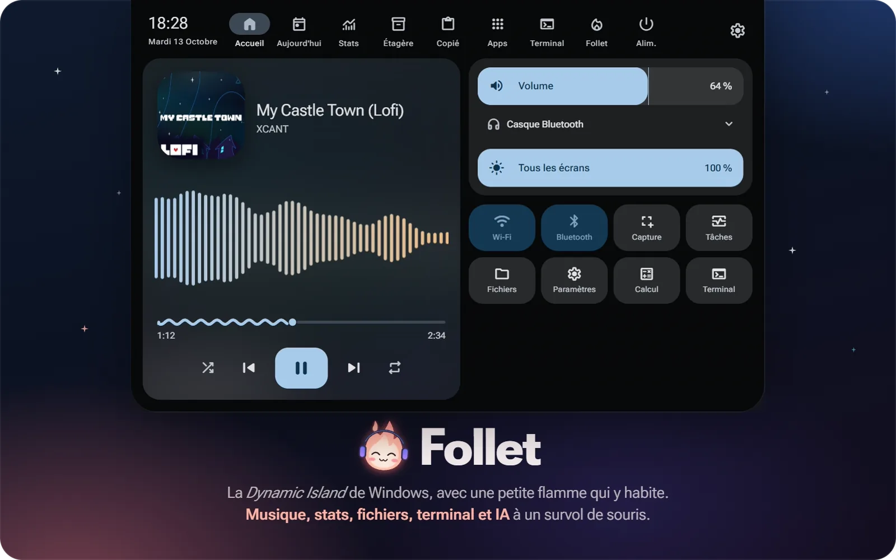
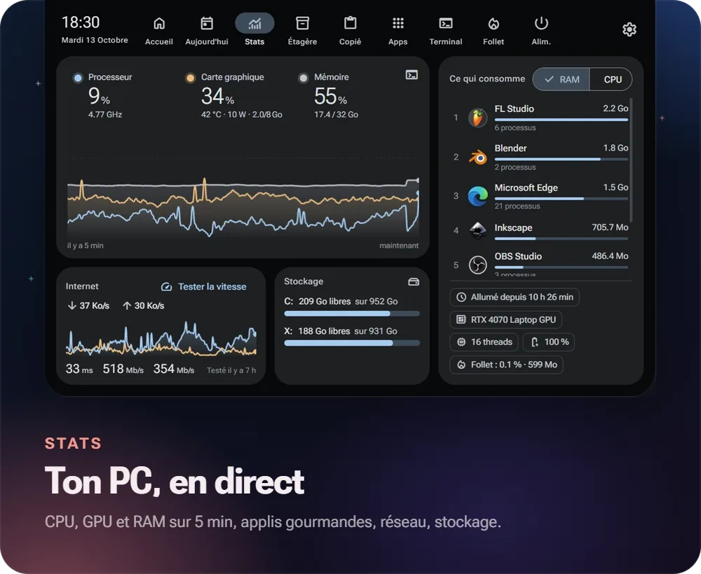
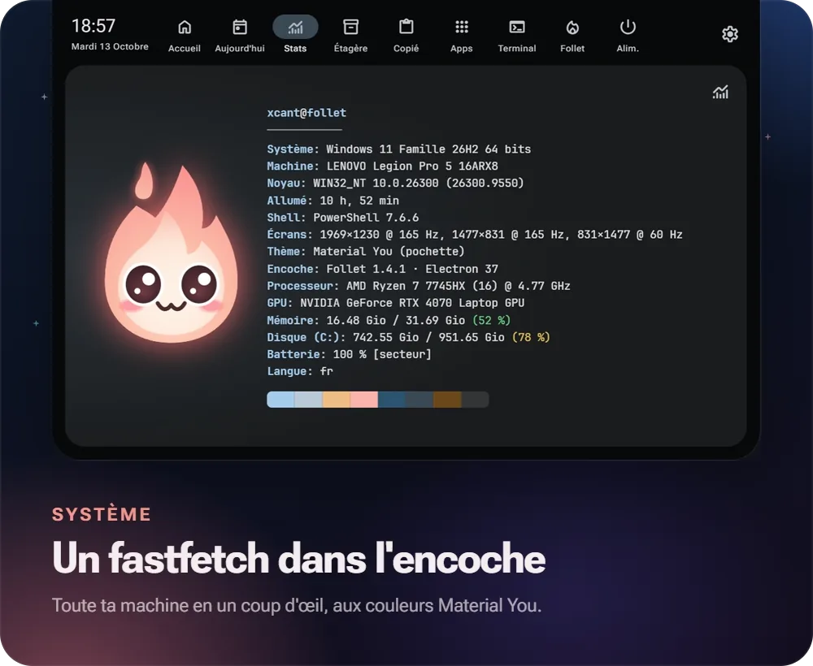
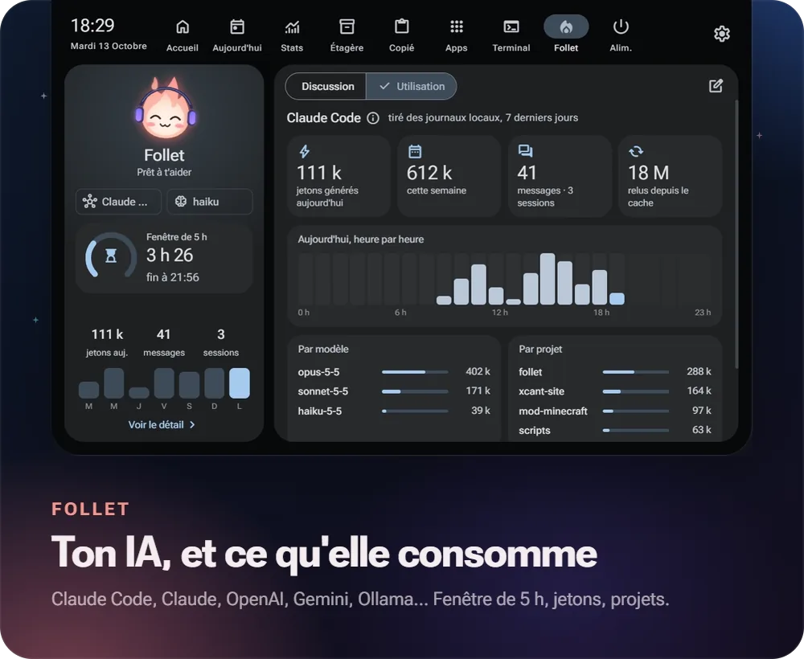
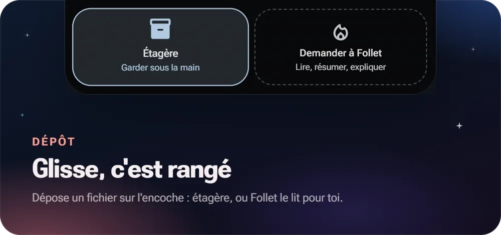

<p align="center"></p>

<p align="center"><a href="README.md">English</a> · <b>Français</b></p>

<p align="center">
  
  
  
  
  <a href="../../releases/latest"></a>
</p>

<table>
  <tr>
    <td width="50%"></td>
    <td width="50%"></td>
  </tr>
  <tr>
    <td width="50%"></td>
    <td width="50%" valign="top"><br><br></td>
  </tr>
</table>

*Un feu follet : la petite flamme du folklore québécois, cousine du hitodama japonais. Musique de démonstration : My Castle Town (Lofi), XCANT.*

## Installation

1. Télécharge **`Follet-Setup-x.y.z.exe`** dans les [releases](../../releases).
2. Lance-le : installation pour ton utilisateur, sans droits administrateur. L'installateur n'est pas signé : à l'écran « Windows a protégé votre ordinateur », clique **Informations complémentaires → Exécuter quand même**.
3. Follet apparaît en haut de l'écran et se présente. Active **Démarrer avec Windows** dans Réglages → Comportement.

Pour que les notifications n'apparaissent que dans Follet, coupe les bannières des applis dans Paramètres Windows → Notifications (ou active Ne pas déranger) : Follet les lit dans le centre de notifications.

Empreinte : installateur de 95 Mo, environ 350 Mo de mémoire et moins de 2 % du processeur au repos (mesuré sur un portable Ryzen 7). Couper l'accélération graphique dans Réglages → Comportement économise environ 70 Mo.

Follet vérifie les nouvelles versions toutes les 6 heures et s'installe à jour depuis Réglages → À propos.

En cas de pépin, le journal est dans `%APPDATA%\Follet\logs\follet.log`.

## Ce qu'elle fait

| Onglet | Contenu |
|---|---|
| **Accueil** | Lecture en cours pour toute appli qui parle à Windows (Spotify, YouTube Music, navigateur…) avec paroles synchronisées, visualiseur (clic sur la pochette pour ramener le lecteur), volume, sortie audio, Wi-Fi, Bluetooth, raccourcis |
| **Aujourd'hui** | Horloge, météo heure par heure et sur 4 jours (position par IP), agenda de la semaine (iCal), historique des notifications, minuteur et Pomodoro affichés dans l'encoche, tâches |
| **Stats** | Courbes CPU (fréquence réelle), GPU NVIDIA et RAM sur 5 min, applis qui consomment, débit réseau et test de vitesse, stockage. Bouton terminal : fiche système façon fastfetch |
| **Étagère** | Glisse des fichiers sur l'encoche, même repliée, pour les garder sous la main, puis fais-les glisser vers n'importe quelle appli |
| **Copié** | Les 50 derniers textes copiés, en mémoire seulement |
| **Apps** | Lanceur avec recherche et favoris, basé sur le menu Démarrer |
| **Terminal** | Shell complet (PowerShell 7 par défaut) |
| **Follet** | Ton IA au choix : Claude Code (ton abonnement), API Claude, OpenAI, Gemini, Ollama (local), OpenRouter ou un serveur compatible. Lit les fichiers texte que tu lui glisses. Tableau de bord d'utilisation : fenêtre de 5 h, jetons, messages, heure par heure, par modèle, par projet |
| **Alim.** | Verrouiller, veille, déconnexion, redémarrer, éteindre |
| **Réglages** | Langue (français ou anglais), couleurs, couleur de Follet, taille et position de l'encoche, écran, raccourci, activités, onglets visibles et leur ordre, météo, agendas, IA |

**Activités en direct.** Repliée, l'encoche s'élargit quelques secondes quand quelque chose se passe : notification Windows, volume, nouvelle chanson, casque connecté, chargeur, batterie faible, minuteur terminé, fichier déposé. Un point orange reste dans l'encoche tant qu'une appli enregistre ton micro, comme sur iPhone.

**Follet a des humeurs.** Écouteurs quand la musique joue, auréole quand l'IA réfléchit, clin d'œil quand la réponse arrive, bonnet de nuit après 5 minutes sans activité, grands yeux pour les alertes.

**Gestes.**
- Survol : aperçu, seulement si la souris s'attarde (un simple passage vers un onglet de navigateur ne l'ouvre pas ; délai réglable). Molette vers le bas ou clic : panneau complet. Échap ou sortir la souris : refermer.
- **Ctrl+Alt+Espace** (modifiable) ouvre et ferme Follet de n'importe où.
- Encoche ouverte : **1 à 9** pour choisir un onglet, **← / →** ou la molette sur les onglets.
- Devant une fenêtre maximisée, l'encoche se range ; elle ressort quand la souris touche le haut de l'écran, au milieu. Elle disparaît pendant un jeu en plein écran.

**Material You.** Tout le thème vient de la pochette en cours, de la couleur d'accent de Windows ou d'une couleur choisie.

## Vie privée

- Les données personnelles (config, tâches, étagère, favoris, conversations, clés d'API chiffrées par Windows) restent dans `%APPDATA%\Follet`, jamais dans le dossier du projet.
- Le presse-papiers n'est jamais écrit sur le disque.
- Aucune télémétrie, aucune statistique d'usage, aucun compte. Follet ne contacte que les services ci-dessous, pour les fonctions qui en ont besoin.
- Services externes : [GitHub](https://github.com) (vérifie s'il y a une nouvelle version toutes les 6 heures), [ipwho.is](https://ipwho.is) / [geojs.io](https://www.geojs.io) (position approximative par IP, désactivable), [Open-Meteo](https://open-meteo.com) (météo), [speed.cloudflare.com](https://speed.cloudflare.com) (test de vitesse, sur demande), [LRCLIB](https://lrclib.net) (paroles : artiste et titre de la chanson en cours, désactivable), les agendas iCal que tu ajoutes et le fournisseur d'IA que tu choisis.

## Développement

Prérequis : Windows 10/11 et [Node.js](https://nodejs.org) 20+. Optionnel : PowerShell 7 (`pwsh`) pour le terminal, [Claude Code](https://claude.com/claude-code) pour l'IA par abonnement, [Libre Hardware Monitor](https://github.com/LibreHardwareMonitor/LibreHardwareMonitor) (serveur web, port 8085) pour la température du CPU, une carte NVIDIA pour les stats GPU.

```bash
npm install
npm start
```

| Commande | Effet |
|---|---|
| `npm start` | Lance Follet depuis le code |
| `npm run check` | Vérifie la syntaxe, `helper.ps1` en ASCII et les versions (aussi lancé par GitHub Actions) |
| `npm run dist` | Construit `dist\Follet-Setup-<version>.exe` |

Si npm bloque le script d'installation d'Electron : `npm install-scripts approve electron`.

### Traductions

Le code est écrit en français ; l'anglais vient de [`src/i18n/en.js`](src/i18n/en.js) (textes exacts et motifs pour les textes avec des nombres). En ajoutant un texte à l'interface, ajoute sa traduction. `node scripts/i18n-extract.js` liste les textes sans traduction, et `FOLLET_EVAL="I.i18nMissing()"` ceux vus à l'écran avec l'appli en anglais.

### Publier une version

1. Ajoute une section à [CHANGELOG.md](CHANGELOG.md).
2. `npm version x.y.z --no-git-tag-version`, puis commit.
3. `git push`, puis `git tag vx.y.z` et `git push origin vx.y.z`.

GitHub Actions construit l'installateur et publie la release avec le texte du CHANGELOG.

### Tester sans souris

- `FOLLET_DEMO=<onglet>` ouvre Follet déployée sur un onglet (`home`, `today`, `stats`, `shelf`, `clip`, `apps`, `term`, `ai`, `power`, `settings`, ou `welcome`) ; `FOLLET_DEMO=1` les fait défiler.
- `FOLLET_EVAL="<expression JS>"` écrit le résultat dans le journal, par exemple `I.activity({kind:'volume', level:42})`.
- `FOLLET_CAPTURE=chemin.png` (avec `FOLLET_EVAL`) enregistre une capture de l'encoche ; avec `FOLLET_CAPTURE_FRAMES=60` (et `FOLLET_CAPTURE_MS=66`), une suite d'images, comme les animations de ce README.
- `FOLLET_FAKE_MEDIA=piste.json` remplace la lecture en cours (`title`, `artist`, `art`, `duration`, `position`) et colore le thème d'après la pochette.

### Structure

```
src/main/
  main.js        démarrage, icône de notification, raccourci global
  core.js        chemins, config, état, journal, utilitaires réseau
  window.js      fenêtre, capture de la souris, intention de survol, rangement, plein écran
  helper.js      pont vers helper.ps1
  helper.ps1     Windows PowerShell 5.1 : média WinRT, volume, sortie audio, batterie,
                 radios, processus, fenêtres, notifications (ASCII seulement)
  theme.js       couleurs Material You (material-color-utilities)
  monitors.js    musique, volume, sortie audio, batterie -> activités
  notifs.js      notifications Windows -> activités
  privacy.js     applis qui enregistrent le micro -> point orange
  lyrics.js      paroles synchronisées depuis LRCLIB
  update.js      mises à jour depuis les releases GitHub
  ai.js          fournisseurs d'IA, clés chiffrées, consommation
  i18n.js        traduction côté processus principal (menu de l'icône)
  stats.js  today.js  tools.js  terminal.js  settings.js
  preload.js     pont sécurisé vers l'interface
src/i18n/en.js   textes anglais
src/renderer/
  css/m3.css     jetons et composants Material 3
  css/notch.css  encoche et onglets
  js/i18n.js     traduction de l'interface
  js/mascot.js   la mascotte (canvas, humeurs)
  js/core.js     états de l'encoche, activités, glisser-déposer
  js/views/      un fichier par onglet
scripts/         vérification, notes de release, extraction des textes à traduire
```

## Politique de signature du code

Les versions Windows sont construites à partir de ce dépôt par [GitHub Actions](.github/workflows/release.yml), uniquement depuis le commit étiqueté. La signature par la [SignPath Foundation](https://signpath.org) est demandée ; en attendant, l'installateur n'est pas signé.

- Auteurs et relecteurs : [XCANT](https://github.com/XCANT)
- Approbateurs (chaque version signée est approuvée à la main) : [XCANT](https://github.com/XCANT)
- Vie privée : voir [Vie privée](#vie-privée). Follet n'envoie rien à d'autres serveurs que ceux qui y sont listés.

## Contribuer

Rapports de bogues, idées et pull requests sont les bienvenus : voir [CONTRIBUTING.md](CONTRIBUTING.md) (en anglais, comme les commits). Failles de sécurité : [SECURITY.md](SECURITY.md).

## Licence

[MIT](LICENSE) © XCANT

## Inspiration

Le look s'inspire de [Hitodama](https://hitodama.in) et des encoches macOS ([boring.notch](https://github.com/TheBoredTeam/boring.notch), NotchNook, Alcove). Follet n'est affilié à aucun de ces projets.
