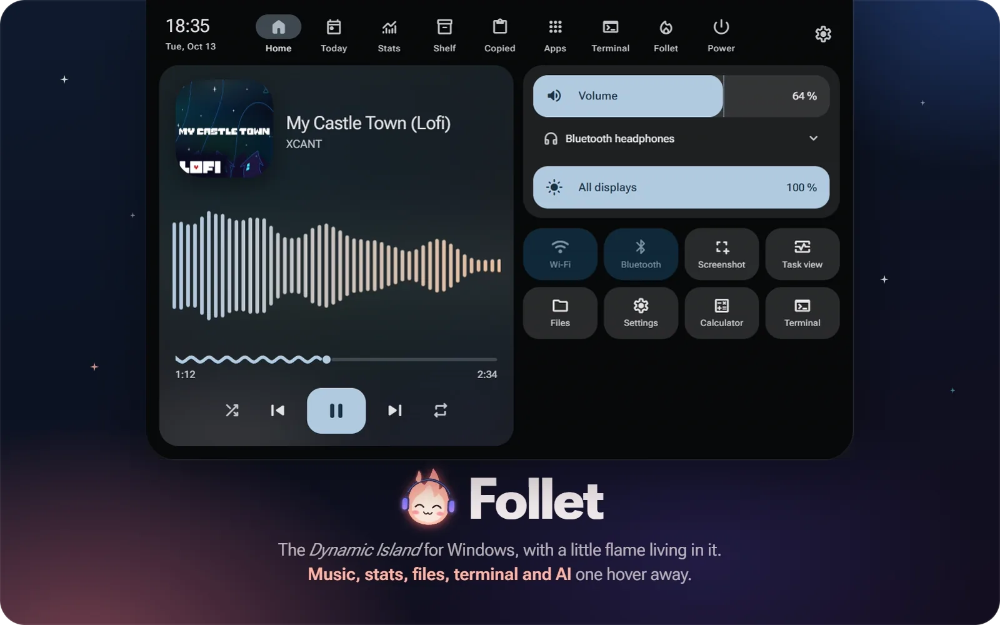
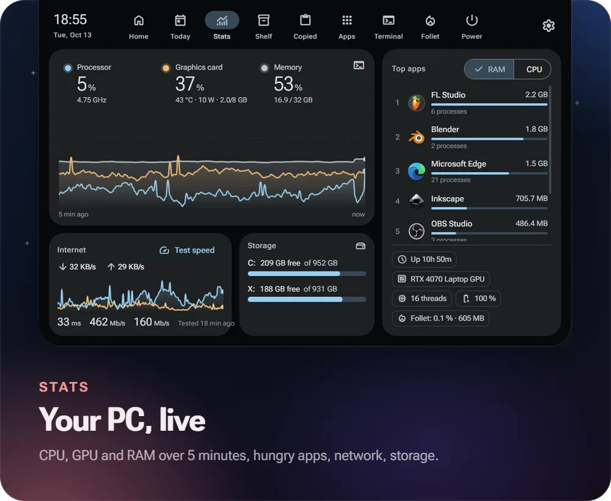
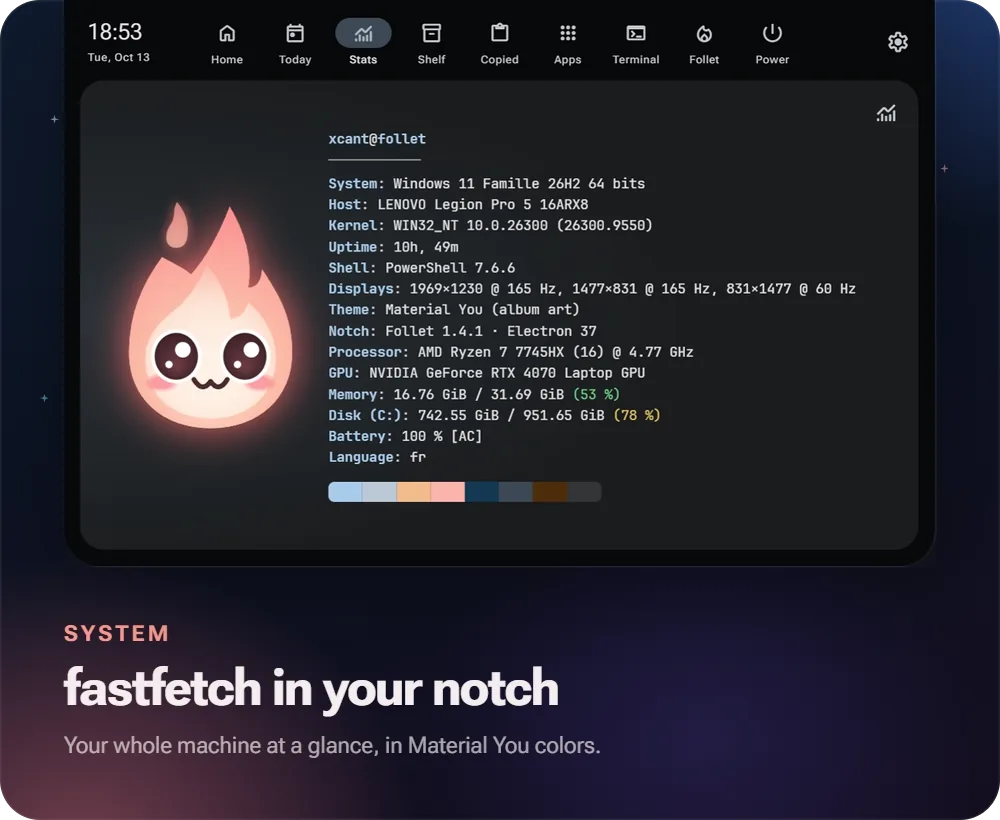
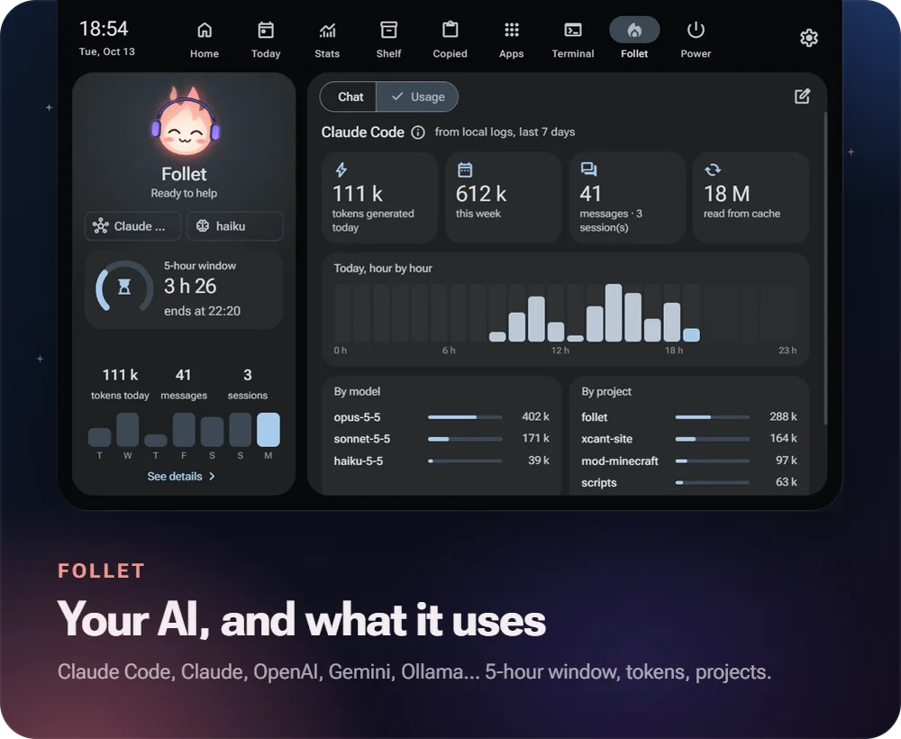
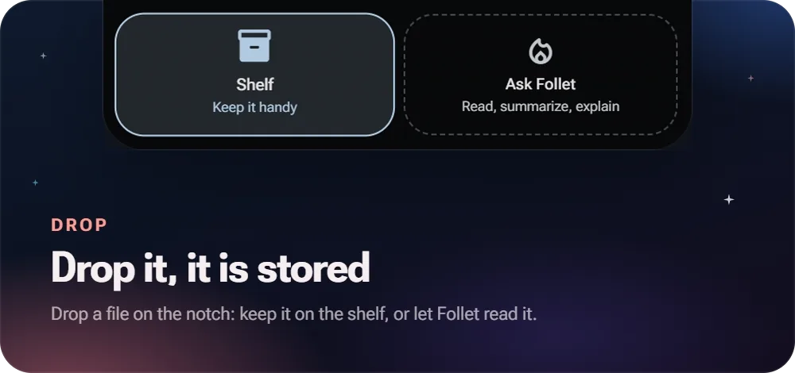
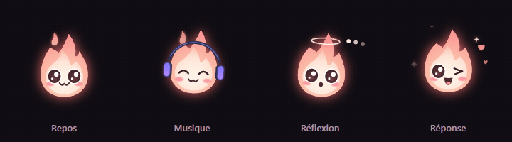

<p align="center"></p>

<p align="center"><b>English</b> · <a href="README.fr.md">Français</a></p>

<p align="center">
  
  
  
  
  <a href="../../releases/latest"></a>
</p>

<table>
  <tr>
    <td width="50%"></td>
    <td width="50%"></td>
  </tr>
  <tr>
    <td width="50%"></td>
    <td width="50%" valign="top"><br><br></td>
  </tr>
</table>

*A Dynamic Island for Windows, with a little flame living in it. A* feu follet *is the will-o'-the-wisp of Québec folklore, a cousin of the Japanese hitodama. Follet speaks English and French. Demo music: My Castle Town (Lofi), XCANT.*

## Install

1. Download **`Follet-Setup-x.y.z.exe`** from the [releases](../../releases).
2. Run it: it installs for your user, no admin rights needed. The installer is not signed: on the "Windows protected your PC" screen, click **More info → Run anyway**.
3. Follet appears at the top of the screen and introduces itself. Turn on **Start with Windows** in Settings → Behavior.

The interface follows the Windows language (French or English). Change it in Settings → Appearance → Language.

To see notifications only in Follet, turn off app banners in Windows Settings → Notifications (or turn on Do not disturb): Follet reads them from the notification center.

Footprint: a 95 MB installer, about 350 MB of memory and under 2 % of the processor at rest (measured on a Ryzen 7 laptop). Turning off hardware acceleration in Settings → Behavior saves about 70 MB.

Follet checks for new versions every 6 hours and updates itself from Settings → About.

If something goes wrong, the log is in `%APPDATA%\Follet\logs\follet.log`.

## What it does

| Tab | Contents |
|---|---|
| **Home** | Now playing for any app that talks to Windows (Spotify, YouTube Music, browser…) with a visualizer, volume, audio output, Wi-Fi, Bluetooth, shortcuts |
| **Today** | Clock, hourly and 4-day weather (location by IP), this week's calendar (iCal), a timer shown in the notch, tasks |
| **Stats** | 5-minute CPU (real clock speed), NVIDIA GPU and RAM charts, top apps, network throughput and speed test, storage. Terminal button: fastfetch-style system info |
| **Shelf** | Drop files on the notch, even collapsed, to keep them handy, then drag them into any app |
| **Copied** | The last 50 copied texts, in memory only |
| **Apps** | Launcher with search and favorites, based on the Start menu |
| **Terminal** | Full shell (PowerShell 7 by default) |
| **Follet** | The AI of your choice: Claude Code (your subscription), Claude API, OpenAI, Gemini, Ollama (local), OpenRouter or a compatible server. Reads the text files you drop on it. Usage dashboard: 5-hour window, tokens, messages, hour by hour, by model, by project |
| **Power** | Lock, sleep, sign out, restart, shut down |
| **Settings** | Language, colors, Follet's color, notch size and position, display, shortcut, activities, visible tabs and their order, weather, calendars, AI |

**Live activities.** When collapsed, the notch widens for a few seconds when something happens: a Windows notification, volume, a new song, headphones connected, charger, low battery, timer done, file dropped. An orange dot stays in the notch while an app is recording your microphone, like on iPhone.

**Follet has moods.** Headphones while music plays, a halo while the AI thinks, a wink when the answer arrives, a nightcap after 5 idle minutes, big eyes for alerts.

**Gestures.**
- Hover: preview, only if the mouse lingers (just passing by on the way to a browser tab does not open it; the delay is adjustable). Scroll down or click: full panel. Esc or move the mouse away: close.
- **Ctrl+Alt+Space** (configurable) opens and closes Follet from anywhere.
- With the notch open: **1 to 9** to pick a tab, **← / →** or the scroll wheel on the tabs.
- In front of a maximized window the notch tucks away; it comes back when the mouse touches the top middle of the screen. It disappears during full-screen games.

**Material You.** The whole theme comes from the current album art, the Windows accent color, or a color you pick.

## Privacy

- Personal data (config, tasks, shelf, favorites, chats, API keys encrypted by Windows) stays in `%APPDATA%\Follet`, never in the project folder.
- The clipboard is never written to disk.
- No telemetry, no analytics, no account. Follet only contacts the services below, for the features that need them.
- External services: [GitHub](https://github.com) (checks for a new release every 6 hours), [ipwho.is](https://ipwho.is) / [geojs.io](https://www.geojs.io) (approximate location by IP, can be turned off), [Open-Meteo](https://open-meteo.com) (weather), [speed.cloudflare.com](https://speed.cloudflare.com) (speed test, on demand), the iCal calendars you add, and the AI provider you choose.

## Development

Requirements: Windows 10/11 and [Node.js](https://nodejs.org) 20+. Optional: PowerShell 7 (`pwsh`) for the terminal, [Claude Code](https://claude.com/claude-code) for subscription AI, [Libre Hardware Monitor](https://github.com/LibreHardwareMonitor/LibreHardwareMonitor) (web server, port 8085) for CPU temperature, an NVIDIA card for GPU stats.

```bash
npm install
npm start
```

| Command | Effect |
|---|---|
| `npm start` | Runs Follet from source |
| `npm run check` | Checks syntax, ASCII-only `helper.ps1` and versions (also run by GitHub Actions) |
| `npm run dist` | Builds `dist\Follet-Setup-<version>.exe` |

If npm blocks Electron's install script: `npm install-scripts approve electron`.

### Translations

The source is written in French. The English UI comes from [`src/i18n/en.js`](src/i18n/en.js): exact strings, plus patterns for text with numbers. When you add French text to the interface, add its English there. `node scripts/i18n-extract.js` lists strings with no translation, and `FOLLET_EVAL="I.i18nMissing()"` lists the ones seen on screen with the app in English.

### Releasing

1. Add a section to [CHANGELOG.md](CHANGELOG.md).
2. `npm version x.y.z --no-git-tag-version`, then commit.
3. `git push`, then `git tag vx.y.z` and `git push origin vx.y.z`.

GitHub Actions builds the installer and publishes the release with the CHANGELOG text.

### Testing without a mouse

- `FOLLET_DEMO=<tab>` opens Follet expanded on a tab (`home`, `today`, `stats`, `shelf`, `clip`, `apps`, `term`, `ai`, `power`, `settings`, or `welcome`); `FOLLET_DEMO=1` cycles through them.
- `FOLLET_EVAL="<JS expression>"` writes the result to the log, for example `I.activity({kind:'volume', level:42})`.
- `FOLLET_CAPTURE=path.png` (with `FOLLET_EVAL`) saves a screenshot of the notch; add `FOLLET_CAPTURE_FRAMES=60` (and `FOLLET_CAPTURE_MS=66`) for a frame sequence, like the animations in this README.
- `FOLLET_FAKE_MEDIA=track.json` replaces what is playing (`title`, `artist`, `art`, `duration`, `position`) and colors the theme from the art.

### Layout

```
src/main/
  main.js        startup, tray icon, global shortcut
  core.js        paths, config, state, log, network helpers
  window.js      window, mouse capture, hover intent, tucking, full screen
  helper.js      bridge to helper.ps1
  helper.ps1     Windows PowerShell 5.1: WinRT media, volume, audio output, battery,
                 radios, processes, windows, notifications (ASCII only)
  theme.js       Material You colors (material-color-utilities)
  monitors.js    music, volume, audio output, battery -> activities
  notifs.js      Windows notifications -> activities
  privacy.js     apps recording the microphone -> orange dot
  update.js      updates from GitHub releases
  ai.js          AI providers, encrypted keys, usage
  i18n.js        main-process translation (tray menu)
  stats.js  today.js  tools.js  terminal.js  settings.js
  preload.js     secure bridge to the interface
src/i18n/en.js   English strings
src/renderer/
  css/m3.css     Material 3 tokens and components
  css/notch.css  notch and tabs
  js/i18n.js     interface translation
  js/mascot.js   the mascot (canvas, moods)
  js/core.js     notch states, activities, drag and drop
  js/views/      one file per tab
scripts/         checks, release notes, translation extraction
```

## Code signing policy

Windows releases are built from this repository by [GitHub Actions](.github/workflows/release.yml), from the tagged commit only. Code signing through the [SignPath Foundation](https://signpath.org) is requested; until it is granted, the installer is not signed.

- Committers and reviewers: [XCANT](https://github.com/XCANT)
- Approvers (each signed release is approved by hand): [XCANT](https://github.com/XCANT)
- Privacy: see [Privacy](#privacy). Follet sends nothing to any server other than the ones listed there.

## Contributing

Bug reports, ideas and pull requests are welcome: see [CONTRIBUTING.md](CONTRIBUTING.md). Security issues: [SECURITY.md](SECURITY.md).

## License

[MIT](LICENSE) © XCANT

## Inspiration

The look is inspired by [Hitodama](https://hitodama.in) and macOS notches ([boring.notch](https://github.com/TheBoredTeam/boring.notch), NotchNook, Alcove). Follet is not affiliated with any of these projects.
