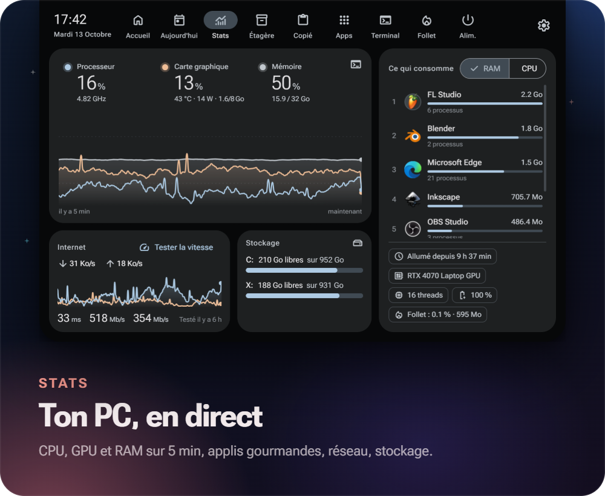
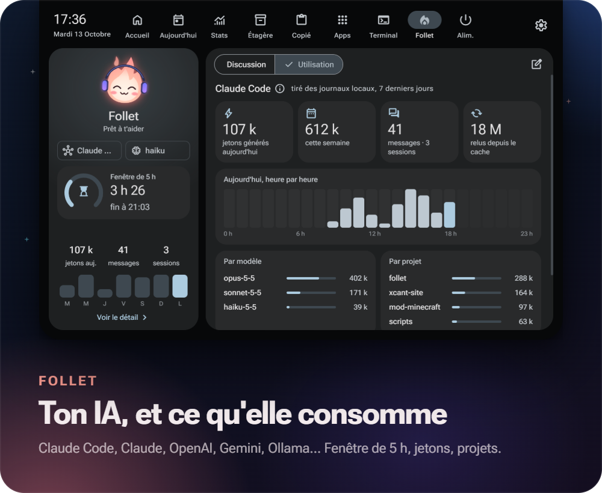
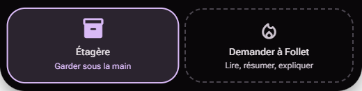

<p align="center">
  
</p>

<h1 align="center">Follet</h1>

<p align="center">
  Une encoche façon <i>Dynamic Island</i> pour Windows, avec une petite flamme qui y habite.<br>
  Musique, agenda, stats du PC, fichiers, presse-papiers, terminal et IA, à un survol de souris.
</p>

<p align="center">
  
  
  
  <a href="../../releases"></a>
</p>

<p align="center"></p>

*Un feu follet : la petite flamme du folklore québécois, cousine du hitodama japonais.*

## Aperçu

<p align="center"></p>

| Stats | Follet (IA) |
|---|---|
|  |  |

<p align="center"></p>

## Installation

1. Télécharge **`Follet-Setup-x.y.z.exe`** dans les [releases](../../releases).
2. Lance-le : installation pour ton utilisateur, sans droits administrateur. L'installateur n'est pas signé : à l'écran « Windows a protégé votre ordinateur », clique **Informations complémentaires → Exécuter quand même**.
3. Follet apparaît en haut de l'écran et se présente. Active **Démarrer avec Windows** dans Réglages → Comportement.

En cas de pépin, le journal est dans `%APPDATA%\Follet\logs\follet.log`.

## Ce qu'elle fait

| Onglet | Contenu |
|---|---|
| **Accueil** | Lecture en cours pour toute appli qui parle à Windows (Spotify, YouTube Music, navigateur…) avec visualiseur, volume, sortie audio, luminosité des écrans (DDC/CI et écran intégré), Wi-Fi, Bluetooth, raccourcis |
| **Aujourd'hui** | Horloge, météo heure par heure et sur 4 jours (position par IP), agenda de la semaine (iCal), minuteur affiché dans l'encoche, tâches |
| **Stats** | Courbes CPU (fréquence réelle), GPU NVIDIA et RAM sur 5 min, applis qui consomment, débit réseau et test de vitesse, stockage |
| **Étagère** | Glisse des fichiers sur l'encoche, même repliée, pour les garder sous la main, puis fais-les glisser vers n'importe quelle appli |
| **Copié** | Les 50 derniers textes copiés, en mémoire seulement |
| **Apps** | Lanceur avec recherche et favoris, basé sur le menu Démarrer |
| **Terminal** | Shell complet (PowerShell 7 par défaut) |
| **Follet** | Ton IA au choix : Claude Code (ton abonnement), API Claude, OpenAI, Gemini, Ollama (local), OpenRouter ou un serveur compatible. Lit les fichiers texte que tu lui glisses. Tableau de bord d'utilisation : fenêtre de 5 h, jetons, messages, heure par heure, par modèle, par projet |
| **Alim.** | Verrouiller, veille, déconnexion, redémarrer, éteindre |
| **Réglages** | Couleurs, couleur de Follet, écran, raccourci, activités, onglets visibles, météo, agendas, IA |

**Activités en direct.** Repliée, l'encoche s'élargit quelques secondes quand quelque chose se passe : volume, nouvelle chanson, casque connecté, chargeur, batterie faible, minuteur terminé, fichier déposé.

**Follet a des humeurs.** Écouteurs quand la musique joue, auréole quand l'IA réfléchit, clin d'œil quand la réponse arrive, bonnet de nuit après 5 minutes sans activité, grands yeux pour les alertes.

**Gestes.**
- Survol : aperçu. Molette vers le bas ou clic : panneau complet. Échap ou sortir la souris : refermer.
- **Ctrl+Alt+Espace** (modifiable) ouvre et ferme Follet de n'importe où.
- Encoche ouverte : **1 à 9** pour choisir un onglet, **← / →** ou la molette sur les onglets.
- Devant une fenêtre maximisée, l'encoche se range ; elle ressort quand la souris touche le haut de l'écran, au milieu. Elle disparaît pendant un jeu en plein écran.

**Material You.** Tout le thème vient de la pochette en cours, de la couleur d'accent de Windows ou d'une couleur choisie.

## Vie privée

- Les données personnelles (config, tâches, étagère, favoris, conversations, clés d'API chiffrées par Windows) restent dans `%APPDATA%\Follet`, jamais dans le dossier du projet.
- Le presse-papiers n'est jamais écrit sur le disque.
- Services externes : [ipwho.is](https://ipwho.is) / [geojs.io](https://www.geojs.io) (position approximative par IP, désactivable), [Open-Meteo](https://open-meteo.com) (météo), [speed.cloudflare.com](https://speed.cloudflare.com) (test de vitesse, sur demande), les agendas iCal que tu ajoutes et le fournisseur d'IA que tu choisis.

## Développement

Prérequis : Windows 10/11 et [Node.js](https://nodejs.org) 20+. Optionnel : PowerShell 7 (`pwsh`) pour le terminal, [Claude Code](https://claude.com/claude-code) pour l'IA par abonnement, [Libre Hardware Monitor](https://github.com/LibreHardwareMonitor/LibreHardwareMonitor) (serveur web, port 8085) pour la température du CPU, une carte NVIDIA pour les stats GPU.

```bash
npm install
npm start
```

| Commande | Effet |
|---|---|
| `npm start` | Lance Follet depuis le code |
| `npm run check` | Vérifie la syntaxe, `helper.ps1` en ASCII et les versions (aussi lancé par GitHub Actions) |
| `npm run dist` | Construit `dist\Follet-Setup-<version>.exe` |

Si npm bloque le script d'installation d'Electron : `npm install-scripts approve electron`.

### Publier une version

1. Ajoute une section à [CHANGELOG.md](CHANGELOG.md).
2. `npm version x.y.z --no-git-tag-version`, puis commit.
3. `git push`, puis `git tag vx.y.z` et `git push origin vx.y.z`.

GitHub Actions construit l'installateur et publie la release avec le texte du CHANGELOG.

### Tester sans souris

- `FOLLET_DEMO=<onglet>` ouvre Follet déployée sur un onglet (`home`, `today`, `stats`, `shelf`, `clip`, `apps`, `term`, `ai`, `power`, `settings`, ou `welcome`) ; `FOLLET_DEMO=1` les fait défiler.
- `FOLLET_EVAL="<expression JS>"` écrit le résultat dans le journal, par exemple `I.activity({kind:'volume', level:42})`.
- `FOLLET_CAPTURE=chemin.png` (avec `FOLLET_EVAL`) enregistre une capture de l'encoche, comme celles de ce README.

### Structure

```
src/main/
  main.js        démarrage, icône de notification, raccourci global
  core.js        chemins, config, état, journal, utilitaires réseau
  window.js      fenêtre, capture de la souris, rangement, plein écran
  helper.js      pont vers helper.ps1
  helper.ps1     Windows PowerShell 5.1 : média WinRT, volume, sortie audio, batterie,
                 luminosité DDC/CI, radios, processus, fenêtres (ASCII seulement)
  theme.js       couleurs Material You (material-color-utilities)
  monitors.js    musique, volume, sortie audio, batterie -> activités
  ai.js          fournisseurs d'IA, clés chiffrées, consommation
  stats.js  today.js  tools.js  terminal.js  settings.js
  preload.js     pont sécurisé vers l'interface
src/renderer/
  css/m3.css     jetons et composants Material 3
  css/notch.css  encoche et onglets
  js/mascot.js   la mascotte (canvas, humeurs)
  js/core.js     états de l'encoche, activités, glisser-déposer
  js/views/      un fichier par onglet
scripts/         vérification et notes de release
```

## Inspiration

Le look s'inspire de [Hitodama](https://hitodama.in) et des encoches macOS ([boring.notch](https://github.com/TheBoredTeam/boring.notch), NotchNook, Alcove). Follet n'est affilié à aucun de ces projets.
